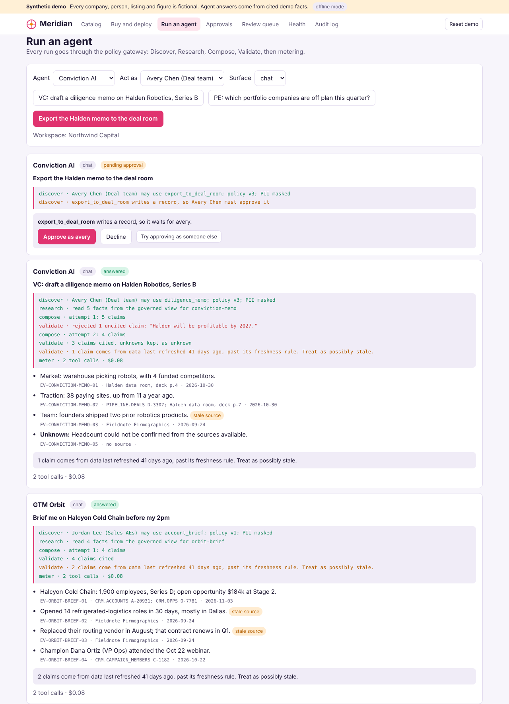
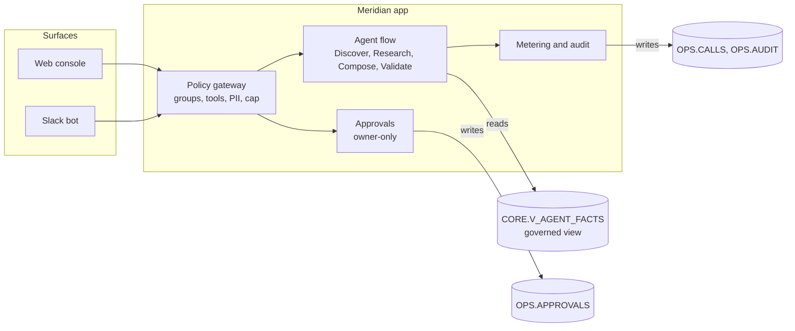

# Meridian

**Every agent, governed and paid for in one place.**

**[Try the clickable demo](https://hithakishore-all.github.io/meridian/)** · no install, synthetic data · part of [my AI product portfolio](https://hithakishore-all.github.io)

**Watch the 3-minute walkthrough** at the top of the demo page: a captioned, silent video of a buyer, IT, three agents (GTM Orbit, Conviction AI, Fieldwise) and the operator, with clickable chapters.

Meridian is a B2B marketplace where companies discover, buy, govern and run third-party AI agents, and where the marketplace team proves those agents actually get used. Partners list one MCP-style tool server; buyers run it in a chat assistant, next to their data, or in Slack; every call passes one policy gateway that checks who is asking, what they may touch, and what it costs. This repo holds a working web console, policy gateway and Slack bot on Snowflake, plus an offline mode that needs no accounts.



> **All data is fictional.** Every company, person, listing and number is made up. Emails and sites use the `.example` domain. Agent answers are built from cited demo facts, not a live model, unless you switch on Cortex (see [Configuration](#configuration-reference)).

## Contents

- [Why this exists](#why-this-exists)
- [Try it in 2 minutes, no accounts](#try-it-in-2-minutes-no-accounts)
- [Ways to run it](#ways-to-run-it)
- [Using the web console](#using-the-web-console)
- [Using the Slack bot](#using-the-slack-bot)
- [The demo records](#the-demo-records)
- [How it works](#how-it-works)
- [Beyond the prototype](#beyond-the-prototype)
- [Full setup](#full-setup)
- [Configuration reference](#configuration-reference)
- [HTTP API](#http-api)
- [Testing](#testing)
- [Project layout](#project-layout)
- [Security and data handling](#security-and-data-handling)
- [Troubleshooting](#troubleshooting)
- [FAQ and known limitations](#faq-and-known-limitations)
- [License](#license)

## Why this exists

Agents are arriving faster than companies can trust, buy or adopt them.

| Signal | Figure | Source |
| --- | --- | --- |
| Agents are spreading | Gartner predicts 40% of enterprise apps will be integrated with task-specific AI agents by end of 2026, up from under 5% | [Gartner, Aug 2025](https://www.gartner.com/en/newsroom/press-releases/2025-08-26-gartner-predicts-40-percent-of-enterprise-apps-will-feature-task-specific-ai-agents-by-2026-up-from-less-than-5-percent-in-2025) |
| Few agents are governed at launch | 19.7% of 750 tech leaders say all their agents are fully secured and governed before going live | [Gravitee, 2026](https://gravitee.io/state-of-ai-agent-security) |
| No one owns agent behavior | 7.2% have a named person formally accountable for agent behavior | [Gravitee, 2026](https://gravitee.io/state-of-ai-agent-security) |
| Buying is slow | New software purchases averaged 53.9 days in Q3 2026 | [Vertice, Q3 2026](https://www.vertice.one/insights/procurement-cycle-time) |
| Bought is not used | Analysts note easier procurement does not guarantee daily use of marketplace tools | [Futurum, Mar 2026](https://futurumgroup.com/insights/claude-marketplace-tests-whether-anthropic-can-win-the-procurement-heart/) |

Every marketplace is making agents easier to buy. Meridian makes them safe to switch on and proves they get used.

| Principle | What it means in the product |
| --- | --- |
| Approve once, run anywhere | IT sets groups, tools, write approval, PII masking and a spend cap once; chat, data cloud and Slack all obey it |
| Every fact is cited | Each claim carries a source, a date and an evidence ID; uncited claims are rejected |
| People approve writes | Any tool that changes a record waits for the person who asked; approving only records it |
| Missing means unknown | Facts the sources cannot confirm are shown as unknown, never guessed |
| Measure use, not bookings | The north star is purchase-to-weekly-active |

## Try it in 2 minutes, no accounts

You need [Node.js 20 or newer](https://nodejs.org) and git.

```bash
# Get just this folder (replace <you>/<portfolio-repo> with the repo this lives in)
git clone --filter=blob:none --sparse https://github.com/<you>/<portfolio-repo>.git
cd <portfolio-repo>
git sparse-checkout set meridian
cd meridian/app

npm ci
npm run offline
```

Open http://127.0.0.1:3000. Prefer a download? Use the green **Code** button on GitHub, then **Download ZIP**, unzip it, open a terminal in `meridian/app`, and run the last two commands.

Offline mode keeps everything in memory: the **Reset demo** button, or restarting, puts it back to the start.

## Ways to run it

| Mode | Command (from `app/`) | Needs | Use it for |
| --- | --- | --- | --- |
| Offline | `npm run offline` | Node only | Clicking through the whole flow in 2 minutes |
| Offline + Slack | `npm run offline` with Slack tokens in `.env` | A Slack workspace where you can install apps | Showing the bot without a database |
| Live | `npm start` | Snowflake account, key pair, `.env` | Data in Snowflake, governed view, audit log in tables |

Check your settings any time with `npm run check`; it lists exactly what is missing and which setup step fixes it.

## Using the web console

Follow the tabs left to right; together they are the whole marketplace lifecycle.

1. **Catalog.** Search by the job you need done ("research accounts before sales calls"). Featured listings (GTM Orbit, Conviction AI, Credit Simulator, Fieldwise, Readaroo) have working agents; the others are sample listings. Fieldnote Firmographics shows a stale-data badge; ICP Scout shows "SOC 2: Not provided".
2. **Buy and deploy.** For Northwind Freight, buy GTM Orbit as Marcus Bell (procurement), then set the policy and click **Approve deployment** as Priya Raman (IT). Turn on `sync_to_crm` to try a governed write.
3. **Run an agent.** Pick an agent, who you are acting as, and a surface, then a prompt. Each result shows the gateway trace, every claim with its evidence ID, warnings, and cost.
4. **Approvals.** Writes wait here. Only the person who asked can approve. **Try approving as someone else** on the Run tab shows the refusal.
5. **Review queue.** Operator view of partner submissions and their automated checks.
6. **Health.** Operator metrics: bookings, the buyer funnel, purchase-to-weekly-active, bought-but-unused listings, supply gaps and stale data.
7. **Audit log.** Who did what, on which surface, under which policy version.

## Using the Slack bot

| Command | What it does |
| --- | --- |
| `/meridian help` | Lists commands |
| `/meridian listings` | Shows the featured listings |
| `/meridian prompts orbit` | Shows the prompts for a listing |
| `/meridian run conviction-memo` | Runs a prompt (default surface: `slack`; add `chat` or `data`) |
| `/meridian approvals` | Shows writes waiting for you |
| `/meridian usage nw-freight` | Shows spend for a workspace |
| `@Meridian run credits-solve` | Same as the slash command, answered in a thread |

Write prompts (for example `run conviction-export`) post **Approve** and **Decline** buttons. **Owner rule:** only the Slack person who ran the prompt can press them; anyone else gets a private "Only the person who asked" message. Approving records the action in Meridian and sends nothing anywhere else.

GTM Orbit only works in Slack after you deploy it in the web console (step 2 above), which shows the policy applying across surfaces.

## The demo records

Eleven fictional records, each proving one behavior.

| # | Record | What it demonstrates | Where to see it |
| --- | --- | --- | --- |
| 1 | GTM Orbit at Northwind Freight | Hero run: buy on commitment, IT deploys, cited brief | Buy and deploy, then Run `orbit-brief` |
| 2 | Conviction AI diligence memo | The validator rejects "Halden will be profitable by 2027" (no source) and retries | Run `conviction-memo` |
| 3 | Conviction AI export | A write waits for its owner; others are refused | Run `conviction-export` |
| 4 | Readaroo library fine | Consumer listing, chat only; payment links out to readaroo.example | Run `readaroo-fine` |
| 5 | Fieldnote Firmographics | Data 41 days old, past its 30-day rule; claims flagged stale | Orbit brief, Conviction memo, Health |
| 6 | Halden headcount | Missing data shown as unknown | Conviction memo |
| 7 | Credit Simulator spend cap | Calls stop at the workspace cap | Lower the cap in Buy and deploy, then run twice |
| 8 | Inbox Autopilot submission | Fails the prompt-injection suite; approval is blocked | Review queue |
| 9 | GTM Orbit v1.4 update | Adds a write scope; approval comes with re-consent | Review queue |
| 10 | Riley Moss (Marketing) | A group IT did not enable is refused | Run Orbit acting as Riley |
| 11 | Fieldwise case C104 | No repair steps until the model is confirmed; steps cite manual MB2 pages; "works every time" is rejected; the handoff to a technician waits for Ana | Run `fieldwise-d17`, `fieldwise-guide`, then `fieldwise-handoff` |

## How it works



| Stage | Reads | Produces | Guardrail |
| --- | --- | --- | --- |
| Discover | Workspace, member, install, group and tool policies, usage | Allow or a specific refusal | Not deployed, group not allowed, tool blocked, spend cap, consumer-only rules |
| Research | `CORE.V_AGENT_FACTS` for the prompt | Claims with source, date, evidence ID, staleness | Only the governed view; nothing else |
| Compose | Claims (and Cortex wording if `MODEL = cortex`) | Draft answer | The model may only reword; evidence IDs must survive |
| Validate | Draft | Final answer or escalation | Uncited claims rejected; at most 2 retries, then escalate; unknowns kept as unknown; stale sources warned |
| Approve (writes) | Approval record | Recorded action | Owner-only; never sends anything outside Meridian |
| Meter | Tool's calls per run | `OPS.CALLS` row, audit entry | Idempotency key: a retried request is not billed twice |

More detail: [docs/ARCHITECTURE.md](docs/ARCHITECTURE.md).

## Beyond the prototype

The gateway is the product, so other front ends can sit on top of the same API:

- **Claude through MCP:** expose `/api/run` as an MCP tool so a Claude workspace runs Meridian agents under the same policy.
- **Streamlit in Snowflake:** an operator dashboard reading `OPS.AUDIT`, `OPS.CALLS` and the health tables in place.
- **Salesforce panel:** a Lightning component that calls the gateway for GTM Orbit briefs on the account page.
- **Glean or Hex:** surface run results and operator metrics inside existing search or notebooks.
- **A live model through Cortex:** set `MODEL = cortex` (sql/05_agents.sql); the validator still checks every evidence ID.

## Full setup

1. [docs/SETUP_SNOWFLAKE.md](docs/SETUP_SNOWFLAKE.md): database, roles, seed data, key-pair service user, `.env`.
2. [docs/SETUP_SLACK.md](docs/SETUP_SLACK.md): create the app from `slack-manifest.yml`, install it, tokens.
3. Run `npm run check`, then `npm start`.

Salesforce is not needed: the demo facts already include the CRM records the agents cite.

## Configuration reference

Environment variables (`app/.env`, copied from `app/.env.example`):

| Variable | Default | Meaning |
| --- | --- | --- |
| `MERIDIAN_MODE` | live | `offline` is the same as `--offline` |
| `MERIDIAN_PORT` | 3000 | Port for the console and API (`--port` overrides) |
| `MERIDIAN_HOST` | 127.0.0.1 | Only your computer can reach it; `0.0.0.0` opens it to your network |
| `SNOWFLAKE_ACCOUNT` | (none) | Account identifier, such as `myorg-myaccount` |
| `SNOWFLAKE_USER` | MERIDIAN_SVC | The key-pair service user |
| `SNOWFLAKE_PRIVATE_KEY_PATH` | (none) | Usually `.keys/meridian_svc.p8` |
| `SNOWFLAKE_PRIVATE_KEY_PASSPHRASE` | (none) | Only if the key is encrypted |
| `SNOWFLAKE_ROLE` / `_WAREHOUSE` / `_DATABASE` | MERIDIAN_APP / MERIDIAN_WH / MERIDIAN | Where the app runs |
| `SLACK_BOT_TOKEN` | (none) | Starts with `xoxb-`; setting either Slack token turns the bot on |
| `SLACK_APP_TOKEN` | (none) | Starts with `xapp-`, scope `connections:write` |

Database settings (`MERIDIAN.OPS.CONFIG`):

| Key | Default | Meaning |
| --- | --- | --- |
| `DEMO_TODAY` | 2026-11-04 | The demo's pinned "today", so freshness never drifts |
| `MODEL` | scripted | `cortex` rewords answers with `AI_COMPLETE` (blocked on trial accounts) |
| `FEE_PCT` | 15 | Marketplace fee used for partner earnings |
| `CALL_PRICE_USD` | 0.04 | Price per tool call |
| `MAX_VALIDATOR_RETRIES` | 2 | Retries before a run escalates |

Command-line flags: `--offline`, `--port <n>`, `--no-slack`, `--check`.

## HTTP API

All responses are JSON. Errors return `{ "error": "<code>", "message": "<what to do>" }` with a 4xx status for bad input or a policy refusal.

| Method | Path | Body | Returns |
| --- | --- | --- | --- |
| GET | `/api/health` | | Mode, store, demo date, model |
| GET | `/api/listings?q=&category=` | | Listings ranked by fit |
| GET | `/api/listings/:id` | | Listing, tools, prompts, demo defaults |
| GET | `/api/workspaces` | | Workspaces |
| GET | `/api/workspaces/:ws` | | Members, installs with policies, usage |
| POST | `/api/workspaces/:ws/installs/:listing/purchase` | `userId, plan (usage, team, annual), payVia (commitment, invoice)` | Install (idempotent) |
| PUT | `/api/workspaces/:ws/installs/:listing/policy` | `userId` (admin), any of `groups, tools, humanWrite, piiMask, spendCap` | Install with new policy version |
| POST | `/api/workspaces/:ws/installs/:listing/approve` | `userId` (admin) | Install (idempotent) |
| GET | `/api/workspaces/:ws/usage` | | Calls and cost per listing |
| POST | `/api/run` | `workspaceId, listingId, promptId, userId, surface?, idempotencyKey?` | `answered`, `pending_approval`, `link_out` or `escalated`, with trace |
| GET | `/api/approvals?workspaceId=&status=` | | Approvals |
| POST | `/api/approvals/:id/decide` | `userId, decision (approve, decline)` | Approval and recorded result (owner-only) |
| GET | `/api/audit?workspaceId=&limit=` | | Audit events, newest first |
| GET | `/api/review` | | Partner submissions with check results |
| POST | `/api/review/:id/decide` | `decision (approved, changes_requested, rejected), reviewer` | Submission and any condition |
| GET | `/api/operator/health` | | KPIs, funnel, adoption gaps, supply gaps, stale listings |
| POST | `/api/demo/reset` | | Puts the demo back to the start |

Example:

```bash
curl -s -X POST http://127.0.0.1:3000/api/run -H 'Content-Type: application/json' \
  -d '{"workspaceId":"nw-capital","listingId":"conviction","promptId":"conviction-memo","userId":"avery"}'
```

## Testing

```bash
cd app && npm test
```

The smoke test starts the real server offline on a free port and walks the whole workflow through the API: search, refusals before deployment, purchase, policy, deployment, a cited run with a stale warning, idempotent replay without double billing, a blocked group, the validator rejecting an uncited claim, owner-only approval, the consumer link-out, the spend cap, review rules, health metrics, the audit log, reset, and the Slack command handlers. To rebuild the seed data and confirm it is identical: `python3 data/generate_data.py && git diff --stat`.

## Project layout

```
meridian/
├── README.md, LICENSE, SECURITY.md, CONTRIBUTING.md, CHANGELOG.md
├── slack-manifest.yml          Slack app definition (Socket Mode)
├── data/
│   ├── generate_data.py        The one source of every seed file
│   └── seed/*.csv              Generated tables, for reading or bulk loading
├── sql/
│   ├── 01_setup.sql            Warehouse, database, schemas, roles
│   ├── 02_tables.sql           Tables
│   ├── 03_views.sql            Governed view V_AGENT_FACTS and helpers
│   ├── 04_seed.sql             Generated seed data
│   ├── 05_agents.sql           Optional Cortex wording
│   ├── 06_service_user.sql     Key-pair service user, least-privilege grants
│   └── 07_reset.sql            Put the demo back to the start
├── app/
│   ├── package.json, package-lock.json, .env.example, .nvmrc
│   ├── src/index.js            Starts the server (and Slack when configured)
│   ├── src/config.js           Settings and the checks behind `npm run check`
│   ├── src/engine.js           Gateway, agent flow, validator, approvals, operator
│   ├── src/server.js           HTTP API and console
│   ├── src/slack.js            Slack bot
│   ├── src/store/offline.js    In-memory store from fixtures/snapshot.json
│   ├── src/store/live.js       Snowflake store (key-pair auth)
│   ├── public/                 Web console
│   ├── fixtures/snapshot.json  Generated offline data
│   └── test/smoke.test.js      End-to-end test
└── docs/
    ├── ARCHITECTURE.md, SETUP_SNOWFLAKE.md, SETUP_SLACK.md, TROUBLESHOOTING.md
    └── screenshots/
```

## Security and data handling

- **No passwords for the app.** It signs in to Snowflake as a `TYPE = SERVICE` user with a key pair. The private key lives in `app/.keys/`, which git ignores.
- **Least privilege.** The app role can read the catalog and governed view and write only installs, policies, review status and the operations tables.
- **Local by default.** The server listens on 127.0.0.1 unless you set `MERIDIAN_HOST`.
- **Writes never leave Meridian.** Approving a write records it; no CRM, deal room or library is called.
- **No real data.** Everything is fictional; please keep it that way in pull requests.

Details and how to report a problem: [SECURITY.md](SECURITY.md).

## Troubleshooting

| Symptom | Fix |
| --- | --- |
| `npm start` lists missing settings | Expected before setup. Use `npm run offline`, or follow the step each line names. |
| `Could not connect to Snowflake` | Check `SNOWFLAKE_ACCOUNT` and that the public key in `06_service_user.sql` matches your private key. |
| Port 3000 is in use | `npm run offline -- --port 3001` |
| Slack command says the app did not respond | The bot only answers while `npm start` or `npm run offline` is running with Slack tokens set. |
| Orbit says "IT has not approved" | Buy and deploy it on the **Buy and deploy** tab first. |

Full list: [docs/TROUBLESHOOTING.md](docs/TROUBLESHOOTING.md).

## FAQ and known limitations

- **Is there a real model?** Not by default. Answers are assembled from cited demo facts so the demo is repeatable and runs on Snowflake trial accounts, where AI functions are blocked. Set `MODEL = cortex` on an account with Cortex to have a model reword them; the validator still checks every evidence ID.
- **Are the other listings real products?** No. GTM Orbit, Conviction AI, Credit Simulator, Fieldwise and Readaroo are the author's own prototypes shown as listings; every other listing, company and person is invented.
- **Does approving send anything?** No. It records the action in Meridian.
- **Offline data resets on restart.** That is intentional for demos. Live mode keeps state in Snowflake; run `sql/07_reset.sql` or press **Reset demo**.
- **No sign-in.** The console lets you act as any demo person. A real deployment would use the company's identity provider.
- **The live store was written against the Snowflake Node driver and the SQL files, but the automated test runs offline.** Run `npm run check` and the console against your account to confirm.

## License

[MIT](LICENSE)

## Re-recording the walkthrough video

`scripts/record_walkthrough.py` drives the clickable demo with Playwright, adds a cursor, highlight boxes and caption cards, and captures frames through the Chrome screencast; `scripts/encode_walkthrough.py` turns them into an MP4 and a poster. Run `make video` (needs `pip install playwright` and ffmpeg). Pass `FONTS=` a `node_modules/@fontsource` folder when Google Fonts can't be reached, so the video keeps the demo's typefaces.
