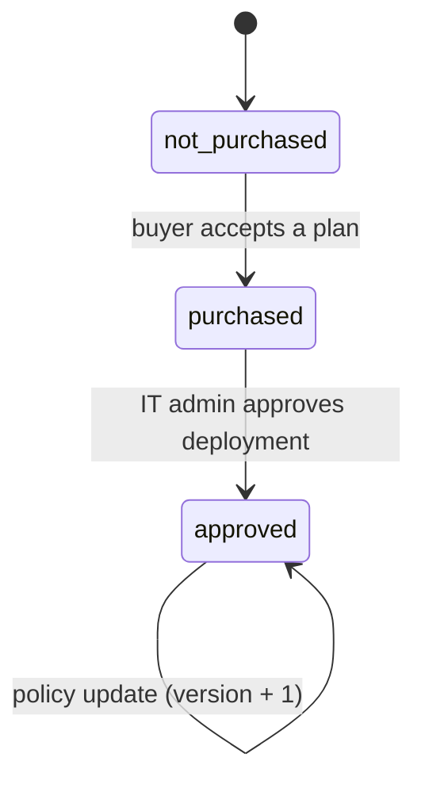
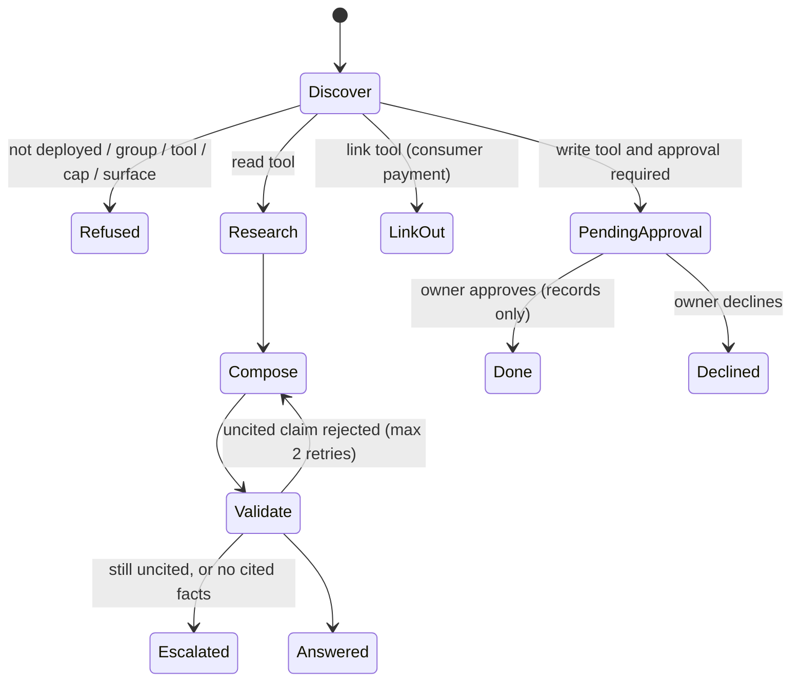

# Architecture

Meridian is one Node process with three front doors (web console, HTTP API, Slack bot) over one engine, and two interchangeable stores (Snowflake, or an in-memory snapshot of the same data).

## Components

| Component | File | Responsibility |
| --- | --- | --- |
| Entry point | `app/src/index.js` | Reads settings, runs config checks, picks the store, starts HTTP and Slack, shuts down cleanly on Ctrl+C |
| Config | `app/src/config.js` | Env vars and flags; `checkConfig` names what is missing and the doc step that fixes it |
| Engine | `app/src/engine.js` | Catalog search, purchase, IT policy, deployment, the policy gateway, agent flow, validator, approvals, metering, review rules, operator metrics |
| HTTP | `app/src/server.js` | JSON API, static console, 4xx errors with plain messages |
| Slack | `app/src/slack.js` | `/meridian` command, mentions, Approve and Decline buttons (Bolt, Socket Mode) |
| Live store | `app/src/store/live.js` | Snowflake via key-pair service user; fully qualified names; empty binds sent as `''` and turned back with `NULLIF` |
| Offline store | `app/src/store/offline.js` | Same interface, backed by `app/fixtures/snapshot.json` |
| Data generator | `data/generate_data.py` | Writes CSVs, `sql/04_seed.sql` and the offline snapshot from one source |

## Data model

`MERIDIAN.CORE` holds the catalog and buyers; `MERIDIAN.OPS` holds config and everything the app records.

| Table | Key columns | Notes |
| --- | --- | --- |
| `CORE.LISTINGS` | `LISTING_ID` | Catalog; data listings carry `DATA_REFRESHED_ON` and `FRESHNESS_RULE_DAYS` |
| `CORE.TOOLS` | `LISTING_ID, TOOL_NAME` | `ACCESS` is `read`, `write` or `link`; `CALLS_PER_RUN` drives metering |
| `CORE.PROMPTS` | `PROMPT_ID` | The demo questions per listing and the tool each uses |
| `CORE.FACTS` | `EVIDENCE_ID` | Every claim an agent can make, with source, date and kind |
| `CORE.WORKSPACES` | `WORKSPACE_ID` | Buyer companies and one personal account |
| `CORE.MEMBERS` | `WORKSPACE_ID, USER_ID` | Group and admin flag per person |
| `CORE.INSTALLS` | `WORKSPACE_ID, LISTING_ID` | Status, plan, payment route, write approval, PII mask, spend cap, policy version |
| `CORE.GROUP_POLICIES`, `CORE.TOOL_POLICIES` | per install | Which groups and tools IT enabled |
| `CORE.SUBMISSIONS` | `SUBMISSION_ID` | Partner submissions and their six automated checks |
| `CORE.BOOKINGS_WEEKLY`, `FUNNEL`, `ADOPTION`, `SUPPLY_GAPS` | | Operator metrics |
| `OPS.CONFIG` | `CONFIG_KEY` | `DEMO_TODAY`, `MODEL`, `FEE_PCT`, `CALL_PRICE_USD`, `MAX_VALIDATOR_RETRIES` |
| `OPS.AUDIT` | `EVENT_ID` | Every action, refusal and decision |
| `OPS.APPROVALS` | `APPROVAL_ID` | Pending and decided writes, with requester and Slack user |
| `OPS.CALLS` | `CALL_ID` | Metered tool calls and cost |
| `OPS.RUNS` | `IDEMPOTENCY_KEY` | Stored results so a retried request returns the same answer |

## The governed view

Agents read only `MERIDIAN.CORE.V_AGENT_FACTS` (a secure view).

| Column | Meaning |
| --- | --- |
| `EVIDENCE_ID` | Stable ID shown next to every claim |
| `PROMPT_ID`, `LISTING_ID`, `TOOL_NAME` | Which question and tool the claim answers |
| `CLAIM` | The sentence |
| `SOURCE` | Where it came from; `NULL` means uncited |
| `AS_OF` | Date of the source |
| `KIND` | `fact`, `unknown`, `uncited`, `action` or `link` |
| `SOURCE_LISTING` | Data listing the claim came from, if any |
| `SOURCE_REFRESHED_ON`, `SOURCE_RULE_DAYS`, `SOURCE_AGE_DAYS` | Freshness inputs |
| `IS_STALE` | True when the source listing is older than its rule, measured from `DEMO_TODAY` |

### Evidence ID pattern

`EV-<PROMPT_ID in capitals>-<two-digit number>`, for example `EV-ORBIT-BRIEF-02` or `EV-CONVICTION-MEMO-05`. Other IDs: approvals `APR-xxxxxxxx`, runs `RUN-xxxxxxxx`, calls `CALL-xxxxxxxx`, audit events `EVT-xxxxxxxx`, submissions `S-5nn`.

## Install states



## Run outcomes



## Agents

Each featured listing is one tool server with read tools and at most one write or link tool.

| Listing | Read tools | Write or link tool | Demo workspace and person |
| --- | --- | --- | --- |
| GTM Orbit | `account_brief`, `buying_signals`, `draft_outreach` | `sync_to_crm` (off until IT enables it) | Northwind Freight, Jordan Lee |
| Conviction AI | `diligence_memo` (VC), `portfolio_monitor` and `add_on_screen` (PE) | `export_to_deal_room` | Northwind Capital, Avery Chen |
| Credit Simulator | `simulate_migration`, `price_solver`, `segment_impact` | `publish_price_book` | Northwind Software, Sam Ortiz |
| Fieldwise | `identify_unit`, `cited_guidance`, `past_fixes` | `start_procedure` | Northwind Field Service, Ana Torres |
| Readaroo | `search_tonight` | `borrow_title`, `family_shelf` (write); `pay_fine` (link) | Jordan's personal account |

## The run result

`POST /api/run` returns:

```json
{
  "run_id": "RUN-1a2b3c4d",
  "status": "answered",
  "workspace_id": "nw-capital", "listing_id": "conviction", "listing_name": "Conviction AI",
  "prompt_id": "conviction-memo", "prompt": "VC: draft a diligence memo on Halden Robotics, Series B",
  "tool": "diligence_memo", "access": "read", "surface": "chat", "user_id": "avery", "policy_version": 3,
  "answer": {
    "claims": [
      { "text": "Traction: 38 paying sites, up from 11 a year ago.", "evidence_id": "EV-CONVICTION-MEMO-02",
        "source": "PIPELINE.DEALS D-3307; Halden data room, deck p.7", "as_of": "2026-10-30",
        "kind": "fact", "stale": false, "source_age_days": null }
    ],
    "text": "Traction: 38 paying sites, up from 11 a year ago. [EV-CONVICTION-MEMO-02]"
  },
  "trace": [ { "stage": "validate", "detail": "rejected 1 uncited claim: \"Halden will be profitable by 2027.\"", "state": "reject" } ],
  "warnings": [ "1 claim comes from data last refreshed 41 days ago, past its freshness rule. Treat as possibly stale." ],
  "usage": { "calls": 2, "cost_usd": 0.08 }
}
```

Other statuses: `pending_approval` (with `approval.approval_id`), `link_out` (with `link.url`), `escalated` (with `reason`). A replayed idempotent request adds `"replayed": true`.

## Event catalog (`OPS.AUDIT.ACTION`)

| Action | When |
| --- | --- |
| `purchase` | A buyer accepts a plan |
| `policy_update` | IT changes groups, tools, write approval, PII masking or the cap |
| `deploy_approved` | IT approves the deployment |
| `run` | A read tool answered |
| `run_blocked` | The gateway refused (group, tool or cap) |
| `run_escalated` | The validator gave up |
| `approval_requested` | A write is waiting for its owner |
| `write_approved`, `write_declined` | The owner decided |
| `link_out` | A consumer payment was handed to the partner |
| `review_decision` | An operator decided on a submission |

## Security model

- **Identity:** the app signs in to Snowflake as `MERIDIAN_SVC` (`TYPE = SERVICE`, RSA key pair, no password). The console has no sign-in; it is a demo where you act as fictional people.
- **Least privilege:** `MERIDIAN_APP` can select the catalog, view and config; update installs, policies and submission status; insert into audit, calls and runs; insert and update approvals. It cannot create or drop objects.
- **Owner-only approvals:** the engine compares the decider with the requester, and in Slack also the Slack user ID.
- **Writes stay inside:** approving records an action; no outside system is called.
- **Network:** listens on 127.0.0.1 by default; Slack uses outbound Socket Mode.
- **Input:** JSON bodies capped at 32 KB; every field validated with a 4xx and a plain message.

## Design decisions

| Decision | Why |
| --- | --- |
| One engine, two stores | The offline demo and the live system behave the same and are tested the same way |
| Scripted wording by default | Repeatable demos, runs on trial accounts; Cortex can reword but never add facts |
| A governed view, not raw tables | One place defines what agents may read and how freshness is judged |
| `DEMO_TODAY` in config | Freshness flags stay the same whenever the demo is shown |
| Idempotency keys | Retries from Slack or the browser never double-bill or double-request approval |
| Purchase-to-weekly-active as north star | Bookings alone hide agents that were bought and abandoned |
